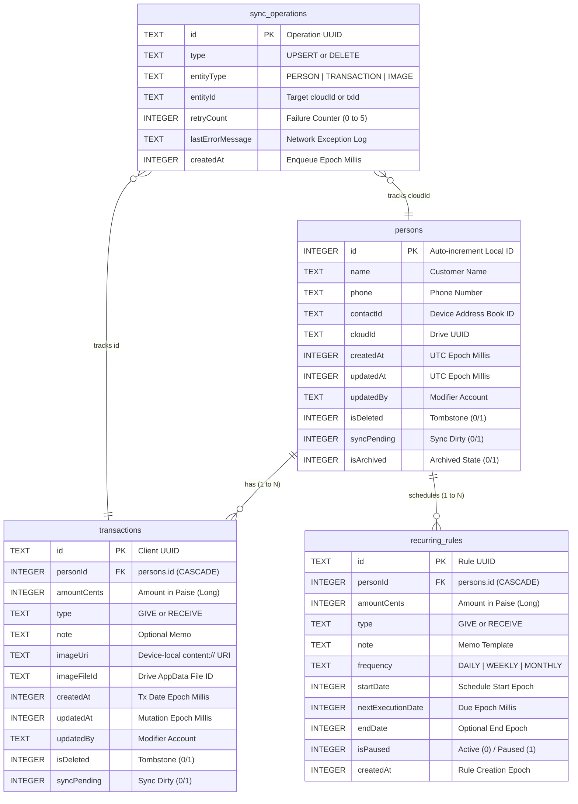

# `DATABASE_SCHEMA.md` — Complete Database Architecture & Schema Reference

**Application:** LedgerApp (`com.kb.ledger`)  
**Package:** `com.kb.ledger`  
**Current Database Version:** `5`  
**Generated & Verified:** October 2026  

---

## 1. Database Overview

### System Architecture & Location
- **Database Filename:** `ledger_database`
- **Underlying Technology:** SQLite 3 (version 3.44+) managed via **Android Jetpack Room 2.6.1** with Kotlin Symbol Processing (KSP).
- **Journal Mode:** Write-Ahead Logging (`WAL`). Transactions are staged in a `-wal` file and synchronized using a `-shm` (shared memory) index.
- **Physical Device Location:**
  ```text
  /data/data/com.kb.ledger/databases/ledger_database
  /data/data/com.kb.ledger/databases/ledger_database-wal
  /data/data/com.kb.ledger/databases/ledger_database-shm
  ```
- **Creation & Opening Mechanism:**
  Single-instance singleton initialized via `AppDatabase.getDatabase(context)` using:
  ```kotlin
  Room.databaseBuilder(
      context.applicationContext,
      AppDatabase::class.java,
      "ledger_database"
  )
  .addMigrations(MIGRATION_2_3, MIGRATION_3_4, MIGRATION_4_5)
  .build()
  ```
  `fallbackToDestructiveMigration()` is **strictly removed**. Room will throw an `IllegalStateException` rather than dropping user tables if an unregistered migration is encountered.

### Other Local Data Stores in Use
Alongside SQLite, the application utilizes the following device stores:
1. **`ledger_security_prefs.xml` (`SharedPreferences`):**
   - Path: `/data/data/com.kb.ledger/shared_prefs/ledger_security_prefs.xml`
   - Stores: Boolean flag `app_lock_enabled` for Biometric/PIN screen lock.
2. **`ledger_theme_prefs.xml` (`SharedPreferences`):**
   - Path: `/data/data/com.kb.ledger/shared_prefs/ledger_theme_prefs.xml`
   - Stores: Selected display theme enum (`SYSTEM`, `LIGHT`, `DARK`).
3. **Android Storage Access Framework (SAF):**
   - On-demand destination chosen by the user when exporting manual JSON backups or CSV statements to external storage / Google Drive downloads.
4. **Transient Android Content Provider Grants:**
   - Stores stringified `content://media/picker/...` URIs in `transactions.imageUri` for bill attachments selected via Android Photo Picker.

---

## 2. Table-by-Table Documentation

The database contains **4 application domain tables** and **3 SQLite / Room internal management tables**.

---

### Table 1: `persons`
- **Purpose:** Stores customer and vendor identities, contact book linkage, archiving state, and cloud synchronization status.
- **Data Classification:** Customer identity, contact metadata, and synchronization state.
- **Actual SQL DDL:**
  ```sql
  CREATE TABLE IF NOT EXISTS `persons` (
      `id` INTEGER PRIMARY KEY AUTOINCREMENT NOT NULL,
      `name` TEXT NOT NULL,
      `phone` TEXT NOT NULL,
      `contactId` TEXT,
      `cloudId` TEXT,
      `createdAt` INTEGER NOT NULL,
      `updatedAt` INTEGER NOT NULL,
      `updatedBy` TEXT,
      `isDeleted` INTEGER NOT NULL DEFAULT 0,
      `syncPending` INTEGER NOT NULL DEFAULT 1,
      `isArchived` INTEGER NOT NULL DEFAULT 0
  );
  ```

#### Column Details
| Column | Type | Nullable | Primary Key | Default | Foreign Key | Purpose / Constraints |
| :--- | :--- | :---: | :---: | :---: | :---: | :--- |
| `id` | `INTEGER` | **NO** | **YES** | Auto-inc | *None* | Device-local auto-increment primary key. Used as foreign key target. |
| `name` | `TEXT` | **NO** | NO | *None* | *None* | Customer display name. |
| `phone` | `TEXT` | **NO** | NO | *None* | *None* | Customer phone number (free-form or normalized digits). |
| `contactId` | `TEXT` | YES | NO | `NULL` | *None* | System `ContactsContract.Contacts._ID` from address book sync. |
| `cloudId` | `TEXT` | YES | NO | `NULL` | *None* | Stable RFC 4122 v4 UUID for Google Drive JSON identity. |
| `createdAt` | `INTEGER` | **NO** | NO | *None* | *None* | Creation timestamp in UTC epoch milliseconds. |
| `updatedAt` | `INTEGER` | **NO** | NO | *None* | *None* | Last modification timestamp in UTC epoch milliseconds (used for LWW sync). |
| `updatedBy` | `TEXT` | YES | NO | `NULL` | *None* | Optional account email or device identifier of last modifier. |
| `isDeleted` | `INTEGER` | **NO** | NO | `0` | *None* | Soft-delete tombstone flag (`0 = active`, `1 = deleted`). Excluded from UI queries. |
| `syncPending` | `INTEGER` | **NO** | NO | `1` | *None* | Dirty flag (`1 = pending upload to Drive`, `0 = synced`). |
| `isArchived` | `INTEGER` | **NO** | NO | `0` | *None* | Archival state (`0 = active`, `1 = archived`). Filtered in UI tabs. |

- **Indexes:** None (lookup by primary key `id`).
- **Uniqueness Constraints:** None at SQLite level. Deduplication is handled at application layer by `ContactSearchHelper`.

---

### Table 2: `transactions`
- **Purpose:** Stores individual financial ledger entries (GIVE and RECEIVE amounts), associated notes, local image references, and Drive synchronization state.
- **Data Classification:** Financial ledger records, bill image references, and synchronization state.
- **Actual SQL DDL:**
  ```sql
  CREATE TABLE IF NOT EXISTS `transactions` (
      `id` TEXT PRIMARY KEY NOT NULL,
      `personId` INTEGER NOT NULL,
      `amountCents` INTEGER NOT NULL,
      `type` TEXT NOT NULL,
      `note` TEXT,
      `imageUri` TEXT,
      `imageFileId` TEXT,
      `createdAt` INTEGER NOT NULL,
      `updatedAt` INTEGER NOT NULL,
      `updatedBy` TEXT,
      `isDeleted` INTEGER NOT NULL DEFAULT 0,
      `syncPending` INTEGER NOT NULL DEFAULT 1,
      FOREIGN KEY(`personId`) REFERENCES `persons`(`id`) ON UPDATE NO ACTION ON DELETE CASCADE
  );
  CREATE INDEX IF NOT EXISTS `index_transactions_personId` ON `transactions` (`personId`);
  ```

#### Column Details
| Column | Type | Nullable | Primary Key | Default | Foreign Key | Purpose / Constraints |
| :--- | :--- | :---: | :---: | :---: | :---: | :--- |
| `id` | `TEXT` | **NO** | **YES** | *None* | *None* | Stable UUID string (generated on client, stable across devices). |
| `personId` | `INTEGER` | **NO** | NO | *None* | `persons(id)` | Foreign key linking transaction to customer. Cascades on deletion. |
| `amountCents` | `INTEGER` | **NO** | NO | *None* | *None* | Financial amount in minor units (paise: ₹1.00 = 100 paise). Eliminates float rounding. |
| `type` | `TEXT` | **NO** | NO | *None* | *None* | Direction: `'GIVE'` (user gives money) or `'RECEIVE'` (user receives money). |
| `note` | `TEXT` | YES | NO | `NULL` | *None* | Optional transaction description / payment remarks. |
| `imageUri` | `TEXT` | YES | NO | `NULL` | *None* | Device-local `content://` URI pointing to receipt image. |
| `imageFileId` | `TEXT` | YES | NO | `NULL` | *None* | Google Drive REST API file ID in `appDataFolder/images/`. |
| `createdAt` | `INTEGER` | **NO** | NO | *None* | *None* | Effective transaction date/time in UTC epoch milliseconds. |
| `updatedAt` | `INTEGER` | **NO** | NO | *None* | *None* | Mutation timestamp in UTC epoch milliseconds (used for LWW sync). |
| `updatedBy` | `TEXT` | YES | NO | `NULL` | *None* | Account identifier of the user who recorded the transaction. |
| `isDeleted` | `INTEGER` | **NO** | NO | `0` | *None* | Soft-delete tombstone flag (`0 = active`, `1 = deleted`). |
| `syncPending` | `INTEGER` | **NO** | NO | `1` | *None* | Dirty flag (`1 = pending upload to Drive`, `0 = synced`). |

- **Indexes:**
  - `index_transactions_personId` on column `(personId)` (optimizes balance and transaction history lookups).
- **Foreign Key Action:**
  - `FOREIGN KEY(personId) REFERENCES persons(id) ON UPDATE NO ACTION ON DELETE CASCADE`.

---

### Table 3: `sync_operations`
- **Purpose:** Durable offline mutation queue. Every local insert, update, or soft-delete writes an operation row before network execution, ensuring mutations survive process death and connectivity loss.
- **Data Classification:** Synchronization queue state.
- **Actual SQL DDL:**
  ```sql
  CREATE TABLE IF NOT EXISTS `sync_operations` (
      `id` TEXT PRIMARY KEY NOT NULL,
      `type` TEXT NOT NULL,
      `entityType` TEXT NOT NULL,
      `entityId` TEXT NOT NULL,
      `retryCount` INTEGER NOT NULL DEFAULT 0,
      `lastErrorMessage` TEXT,
      `createdAt` INTEGER NOT NULL
  );
  ```

#### Column Details
| Column | Type | Nullable | Primary Key | Default | Foreign Key | Purpose / Constraints |
| :--- | :--- | :---: | :---: | :---: | :---: | :--- |
| `id` | `TEXT` | **NO** | **YES** | *None* | *None* | UUID string identifying the queued task. |
| `type` | `TEXT` | **NO** | NO | *None* | *None* | Mutation type: `'UPSERT'` or `'DELETE'`. |
| `entityType` | `TEXT` | **NO** | NO | *None* | *None* | Target entity: `'PERSON'`, `'TRANSACTION'`, or `'IMAGE'`. |
| `entityId` | `TEXT` | **NO** | NO | *None* | *None* | Cloud identifier (`cloudId` for Person, UUID `id` for Transaction). |
| `retryCount` | `INTEGER` | **NO** | NO | `0` | *None* | Number of failed sync attempts. Abandoned after `MAX_RETRIES = 5`. |
| `lastErrorMessage` | `TEXT` | YES | NO | `NULL` | *None* | Exception message from the last failed network synchronization. |
| `createdAt` | `INTEGER` | **NO** | NO | *None* | *None* | UTC epoch milliseconds when operation was enqueued. |

---

### Table 4: `recurring_rules`
- **Purpose:** Stores automated repeating transaction schedules (rent, daily supply, weekly subscriptions).
- **Data Classification:** Automation templates.
- **Actual SQL DDL:**
  ```sql
  CREATE TABLE IF NOT EXISTS `recurring_rules` (
      `id` TEXT PRIMARY KEY NOT NULL,
      `personId` INTEGER NOT NULL,
      `amountCents` INTEGER NOT NULL,
      `type` TEXT NOT NULL,
      `note` TEXT,
      `frequency` TEXT NOT NULL,
      `startDate` INTEGER NOT NULL,
      `nextExecutionDate` INTEGER NOT NULL,
      `endDate` INTEGER,
      `isPaused` INTEGER NOT NULL,
      `createdAt` INTEGER NOT NULL,
      FOREIGN KEY(`personId`) REFERENCES `persons`(`id`) ON UPDATE NO ACTION ON DELETE CASCADE
  );
  CREATE INDEX IF NOT EXISTS `index_recurring_rules_personId` ON `recurring_rules` (`personId`);
  ```

#### Column Details
| Column | Type | Nullable | Primary Key | Default | Foreign Key | Purpose / Constraints |
| :--- | :--- | :---: | :---: | :---: | :---: | :--- |
| `id` | `TEXT` | **NO** | **YES** | *None* | *None* | UUID string identifying the template. |
| `personId` | `INTEGER` | **NO** | NO | *None* | `persons(id)` | Foreign key linking schedule to customer. Cascades on customer delete. |
| `amountCents` | `INTEGER` | **NO** | NO | *None* | *None* | Repeating amount in paise (integer). |
| `type` | `TEXT` | **NO** | NO | *None* | *None* | Direction: `'GIVE'` or `'RECEIVE'`. |
| `note` | `TEXT` | YES | NO | `NULL` | *None* | Base description for generated transactions. |
| `frequency` | `TEXT` | **NO** | NO | *None* | *None* | Cadence: `'DAILY'`, `'WEEKLY'`, or `'MONTHLY'`. |
| `startDate` | `INTEGER` | **NO** | NO | *None* | *None* | Epoch milliseconds of initial occurrence. |
| `nextExecutionDate` | `INTEGER` | **NO** | NO | *None* | *None* | Epoch milliseconds when the next transaction is due. |
| `endDate` | `INTEGER` | YES | NO | `NULL` | *None* | Optional expiry epoch milliseconds (null = indefinite). |
| `isPaused` | `INTEGER` | **NO** | NO | *None* | *None* | Status flag (`0 = active`, `1 = paused/completed`). |
| `createdAt` | `INTEGER` | **NO** | NO | *None* | *None* | Rule creation timestamp in UTC epoch milliseconds. |

- **Indexes:**
  - `index_recurring_rules_personId` on column `(personId)`.
- **Foreign Key Action:**
  - `FOREIGN KEY(personId) REFERENCES persons(id) ON UPDATE NO ACTION ON DELETE CASCADE`.

---

### Internal SQLite & Room Tables

1. **`room_master_table`:**
   - DDL: `CREATE TABLE IF NOT EXISTS room_master_table (id INTEGER PRIMARY KEY, identity_hash TEXT)`
   - Purpose: Stores Room's compile-time schema hash (`56bed596b10e46bacb580a10f46c529b` for v5). Room validates this hash on database open to detect mismatched entity definitions.
2. **`sqlite_sequence`:**
   - DDL: Standard SQLite internal engine table.
   - Purpose: Tracks the current maximum auto-increment sequence number for `persons.id`.
3. **`android_metadata`:**
   - DDL: `CREATE TABLE android_metadata (locale TEXT)`
   - Purpose: Stores default device locale string (`en_US`) generated by Android SQLite framework.

---

## 3. Entity Relationship (ER) Diagram



### Relationship Mechanics & Invariants

1. **Transaction Linkage:**
   - Every transaction links to a customer via `transactions.personId = persons.id`.
   - Index `index_transactions_personId` ensures fast grouping for running balances.
2. **Customer Archiving:**
   - Archiving executes `UPDATE persons SET isArchived = 1, syncPending = 1 WHERE id = :id`.
   - **No cascading effect:** All associated transactions remain untouched and active. Balance calculations continue to include archived customers until they are restored or deleted.
3. **Customer Deletion (Settled Customers):**
   - Soft-delete: The customer and all their transactions are flagged `isDeleted = 1`, and tombstones are queued in `sync_operations`.
   - Hard-delete (if raw SQLite `DELETE FROM persons` occurs): `ON DELETE CASCADE` automatically removes child `transactions` and `recurring_rules`.
4. **Idempotent Recurring Occurrence Generation:**
   - Recurring transactions generate deterministic primary keys: `id = "rec_${rule.id}_${executionDate}"`.
   - If an occurrence generation job re-runs across a device restart or network retry, the identical primary key guarantees zero duplicate rows in `transactions`.

---

## 4. Fictional Example Records

> **PRIVACY GUARANTEE:** All data below is 100% fictional and illustrative. No actual user or customer records are shown.

### Fictional Customer (`persons` Table)
```json
{
  "id": 401,
  "name": "Jane Doe",
  "phone": "+1 555-0199",
  "contactId": "raw_contact_8841",
  "cloudId": "d3b07384-d113-4660-9d82-959c8699195b",
  "createdAt": 1792400000000,
  "updatedAt": 1792486400000,
  "updatedBy": "business.owner@example.com",
  "isDeleted": 0,
  "syncPending": 0,
  "isArchived": 0
}
```

### Fictional Ledger Transaction (`transactions` Table)
```json
{
  "id": "e4eaaaf2-a142-4b13-bb15-379f30f325d8",
  "personId": 401,
  "amountCents": 125050,
  "type": "RECEIVE",
  "note": "Payment for invoice #1042",
  "imageUri": "content://media/picker/0/com.android.providers.media.photopicker/media/1000000042",
  "imageFileId": "1a2B3c4D5e6F7g8H9i0J_drive_file_id",
  "createdAt": 1792486400000,
  "updatedAt": 1792486400000,
  "updatedBy": "business.owner@example.com",
  "isDeleted": 0,
  "syncPending": 0
}
```

### Fictional Recurring Rule (`recurring_rules` Table)
```json
{
  "id": "7c9e6679-7425-40de-944b-e07fc1f90ae7",
  "personId": 401,
  "amountCents": 50000,
  "type": "GIVE",
  "note": "Weekly office supplies",
  "frequency": "WEEKLY",
  "startDate": 1792400000000,
  "nextExecutionDate": 1793004800000,
  "endDate": null,
  "isPaused": 0,
  "createdAt": 1792400000000
}
```

### Fictional Offline Sync Queue Row (`sync_operations` Table)
```json
{
  "id": "2b0f4d30-8025-4122-8eb7-910a8d672ef1",
  "type": "UPSERT",
  "entityType": "TRANSACTION",
  "entityId": "e4eaaaf2-a142-4b13-bb15-379f30f325d8",
  "retryCount": 0,
  "lastErrorMessage": null,
  "createdAt": 1792486400000
}
```

---

## 5. Database IDs vs. User-Facing Presentation

| Field / Attribute | Internal Database Representation | User-Facing Presentation in UI | Rationale |
| :--- | :--- | :--- | :--- |
| **Transaction Amount** | `amountCents: Long` (e.g. `125050`) | `₹1,250.50` | Prevents binary floating-point rounding bugs (`0.1 + 0.2 != 0.3`). Database never stores float/double. |
| **Customer ID** | `id: Long` (auto-increment) | Hidden (never displayed) | Internal database identifier. Technical IDs (`(ID: #401)`) were explicitly removed to eliminate visual clutter. |
| **Transaction ID** | `id: String` (UUID) | Hidden (never displayed) | Guarantees global uniqueness across offline devices without server coordination. |
| **Cloud Identity** | `cloudId: String` (UUID) | Hidden (never displayed) | Stable identity for Google Drive JSON files (`persons.json`). Decouples phone's local row ID from other devices. |
| **Timestamps** | `INTEGER` epoch milliseconds (e.g. `1792486400000`) | `23 Oct 2026, 01:09 pm` | Compact, timezone-neutral integer storage; formatted for user's local timezone at display time. |
| **Soft Deletes** | `isDeleted: INTEGER` (`1`) | Hidden (filtered out) | Allows tombstone synchronization to Google Drive so secondary devices know to delete the record. |
