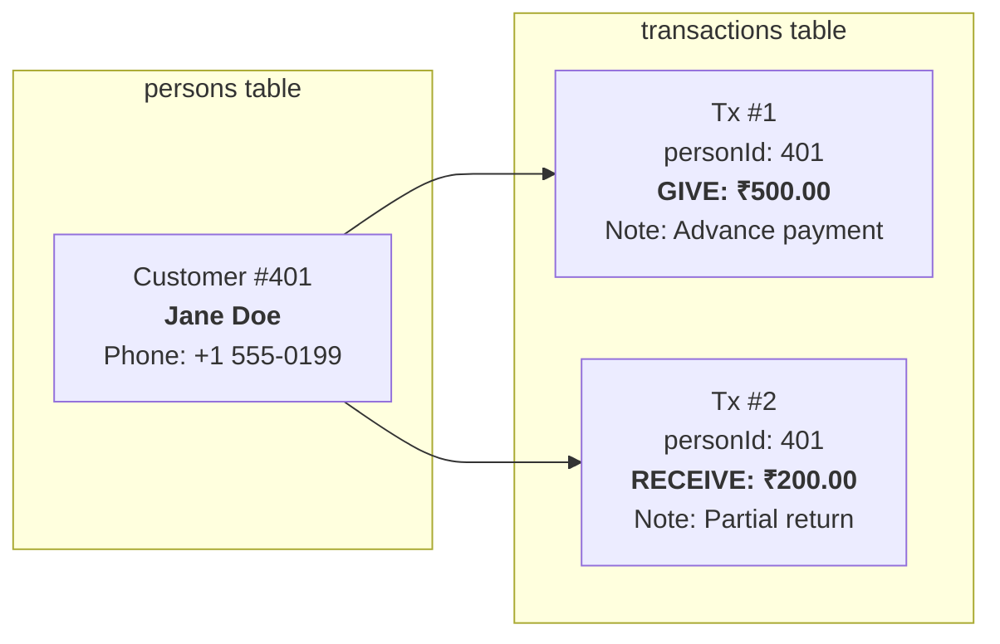
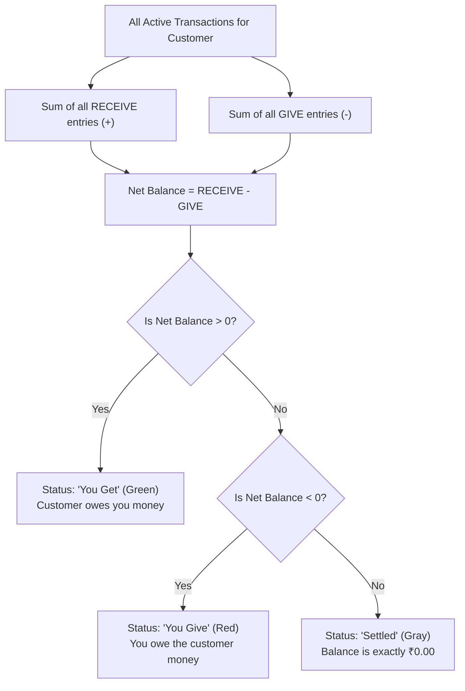
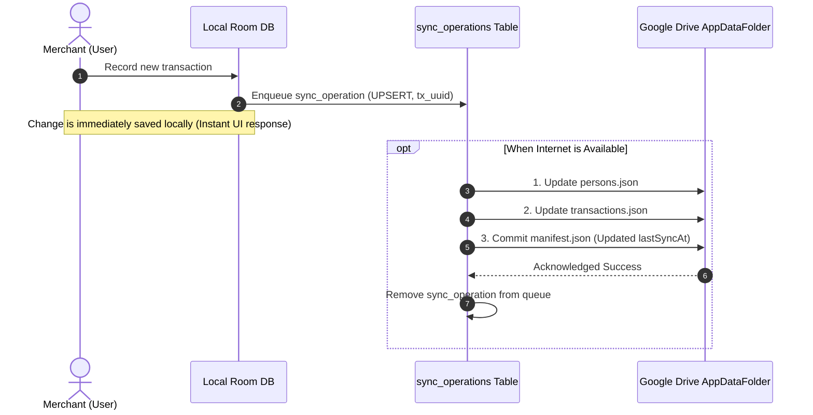

# `DATABASE_VISUAL_GUIDE.md` — Visual Architecture, Backup & Inspection Guide

**Application:** LedgerApp (`com.kb.ledger`)  
**Package:** `com.kb.ledger`  
**Target Audience:** Users, administrators, and developers seeking an intuitive understanding of the app's local data storage, cloud sync, and backup procedures.

---

## 1. What is a Database File?

Think of a database file as a digital filing cabinet stored on your Android phone:
- Rather than scattering notes across hundreds of small text files, the entire ledger (all customers, transactions, recurring rules, and sync logs) is organized inside a single, highly structured, high-speed file called **`ledger_database`**.
- It is powered by **SQLite**, the world's most battle-tested mobile database engine.
- When the app is running, SQLite uses two temporary companion helper files:
  1. **`ledger_database-wal` (Write-Ahead Log):** An active scratchpad where new transactions and customer edits are quickly written before being merged into the main file.
  2. **`ledger_database-shm` (Shared Memory):** An index memory map that coordinates fast read/write access between app threads.

```text
┌───────────────────────────────────────────────────────────┐
│                    Android Application                    │
│                        com.kb.ledger                      │
└─────────────────────────────┬─────────────────────────────┘
                              │
                    Android SQLite Engine
                              │
     ┌────────────────────────┼────────────────────────┐
     ▼                        ▼                        ▼
┌──────────────┐       ┌──────────────┐       ┌──────────────┐
│ledger_database       │-wal (Scratch)│       │-shm (Memory) │
│ (Main File)  │       │(Pending Data)│       │(Index Cache) │
└──────────────┘       └──────────────┘       └──────────────┘
```

---

## 2. What Each Table Stores in Plain Language

| Table Name | Real-World Analogy | What It Stores |
| :--- | :--- | :--- |
| **`persons`** | The Address Book | Every person or business you deal with. Stores their name, phone number, whether they are archived, and a unique cloud identity. |
| **`transactions`** | The Account Ledger | Every payment entry. Stores who it was with, how much was paid or received, whether it was GIVE or RECEIVE, optional notes, and bill image links. |
| **`recurring_rules`** | The Standing Instructions | Automated schedules that periodically add repeat entries (such as daily milk, weekly supplies, or monthly rent) on a set date. |
| **`sync_operations`** | The Outbox Queue | A queue of pending changes waiting to be uploaded to your Google Drive when your phone is connected to the internet. |

---

## 3. How Customer Records Link to Transactions

Every customer in `persons` has a unique number: `id` (e.g., Customer #401).

When you record a transaction, the app records `personId = 401` in the `transactions` table. This creates a link:



---

## 4. How the App Calculates Ledger Balances

The ledger uses **paise-exact integer arithmetic** (`amountCents: Long` where ₹1.00 = 100 paise) so you never experience rounding errors.

The calculation rule is:
$$\text{Net Balance} = \sum (\text{RECEIVE}) - \sum (\text{GIVE})$$



### Concrete Calculation Example:
1. You give Jane Doe ₹500.00 (`GIVE 50000 paise`).
2. Jane Doe gives you ₹200.00 (`RECEIVE 20000 paise`).
3. **Calculation:** $20000 - 50000 = -30000\text{ paise} = -₹300.00$.
4. **App Display:** Customer card shows **You Give ₹300.00** in red.

---

## 5. Where Bill Images Are Stored

Receipt images have two locations in this architecture:

1. **Local Phone Storage (`imageUri`):**
   - When you select a receipt photo using the Android Photo Picker, Android gives the app a temporary address (e.g., `content://media/picker/...`).
   - The app stores this string in the `imageUri` column.
   - **Important note:** This address points directly to your phone's gallery. If you delete the photo from your gallery or switch phones, this local link can no longer open the photo.
2. **Cloud Drive Storage (`imageFileId`):**
   - When connected to Google Drive, the receipt file is uploaded to your private `appDataFolder/images/`.
   - Google Drive gives the image a permanent ID (e.g., `1a2B3c4D5e6F...`).
   - Storing this `imageFileId` ensures your bill receipt can be downloaded on a new phone even if your old phone is lost or replaced.

---

## 6. What the Cloud Synchronization Manifest Contains

When you sign in with Google Drive, the app creates three files in your private `appDataFolder`:
1. `manifest.json`: The control certificate for your ledger.
2. `persons.json`: All your customer identities and tombstones.
3. `transactions.json`: All your ledger entries.

### Actual Wire JSON Format Examples (Fictional Data)

#### A. `manifest.json`
```json
{
  "schemaVersion": 1,
  "appVersion": "1.0",
  "ledgerId": "a1b2c3d4-e5f6-47a8-b9c0-112233445566",
  "ownerId": "merchant.account@gmail.com",
  "createdAt": "2026-10-23T08:00:00Z",
  "lastSyncAt": "2026-10-24T10:30:00Z"
}
```

#### B. `persons.json`
```json
{
  "schemaVersion": 1,
  "records": [
    {
      "cloudId": "d3b07384-d113-4660-9d82-959c8699195b",
      "localId": 401,
      "name": "Jane Doe",
      "phone": "+1 555-0199",
      "contactId": "contact_9821",
      "createdAt": "2026-10-23T08:00:00Z",
      "updatedAt": "2026-10-24T10:30:00Z",
      "updatedBy": "merchant.account@gmail.com",
      "isDeleted": false
    }
  ]
}
```

#### C. `transactions.json`
```json
{
  "schemaVersion": 1,
  "records": [
    {
      "id": "e4eaaaf2-a142-4b13-bb15-379f30f325d8",
      "personCloudId": "d3b07384-d113-4660-9d82-959c8699195b",
      "amountCents": 50000,
      "type": "GIVE",
      "note": "Advance payment for goods",
      "imageFileId": "1a2B3c4D5e6F7g8H9i0J_drive_file_id",
      "createdAt": "2026-10-23T08:00:00Z",
      "updatedAt": "2026-10-24T10:30:00Z",
      "updatedBy": "merchant.account@gmail.com",
      "isDeleted": false
    }
  ]
}
```

---

## 7. How Changes Reach Google Drive (Write-Ahead Architecture)

The app prevents corrupted or partial cloud uploads using a **Write-Ahead Commitment Pipeline**:



### How Interrupted or Failed Syncs are Handled:
- If your phone loses internet connection while saving, the task remains safely recorded in `sync_operations`.
- The app automatically retries on the next sync attempt (up to 5 retries).
- Because `manifest.json` is updated last, a phone checking Google Drive will never mistake a half-uploaded backup for a complete ledger.
- If a downloaded cloud file fails schema validation, the app rejects it before touching your local database.
- **Overwrite Protection:** If your local database is empty (e.g. after a clean reinstall), the app refuses to overwrite non-empty cloud records.

---

## 8. What Files are Required for a Complete Restore?

Depending on how you backup, here is what you need:

### Option A: Complete Raw SQLite File Snapshot (Best for Exact Local Cloning)
To restore the complete state without any loss, you must copy **all three files**:
1. `ledger_database`
2. `ledger_database-wal`
3. `ledger_database-shm`
*(If SQLite has checkpointed, the main file alone is sufficient, but keeping all three guarantees zero loss).*

### Option B: Cloud Restore (Google Drive)
The app reconstructs the entire database automatically from:
1. `manifest.json`
2. `persons.json`
3. `transactions.json`
*(Receipt image files in `appDataFolder/images/` are downloaded on-demand when viewing transactions).*

---

## 9. How to Locate the Database Using Android Studio Device Explorer

1. Connect your Android phone with **USB Debugging** enabled.
2. In Android Studio, open the **Device Explorer** tool window (usually on the right sidebar, or via `View > Tool Windows > Device File Explorer`).
3. In the device dropdown, select your connected device (e.g., `CPH2423`).
4. Navigate through the directory tree:
   ```text
   /
   └── data/
       └── data/
           └── com.kb.ledger/
               └── databases/
                   ├── ledger_database
                   ├── ledger_database-shm
                   └── ledger_database-wal
   ```
5. Select all three files, right-click, and choose **Save As...** to save a copy onto your computer.

---

## 10. How to Safely View the Database in DB Browser for SQLite

1. Download and install [DB Browser for SQLite](https://sqlitebrowser.org/) (available for Mac, Windows, Linux).
2. Place the copied `ledger_database`, `ledger_database-wal`, and `ledger_database-shm` in the same computer folder.
3. Open **DB Browser for SQLite** and click **Open Database (Read Only)**.
4. Select `ledger_database`.
5. **Explore Data:**
   - Click the **Browse Data** tab and choose `persons` or `transactions` from the dropdown table list.
6. **Execute Diagnostic Queries:**
   - Click the **Execute SQL** tab.
   - Open and run `database_inspection.sql` to view health metrics, row counts, and summary statistics.
